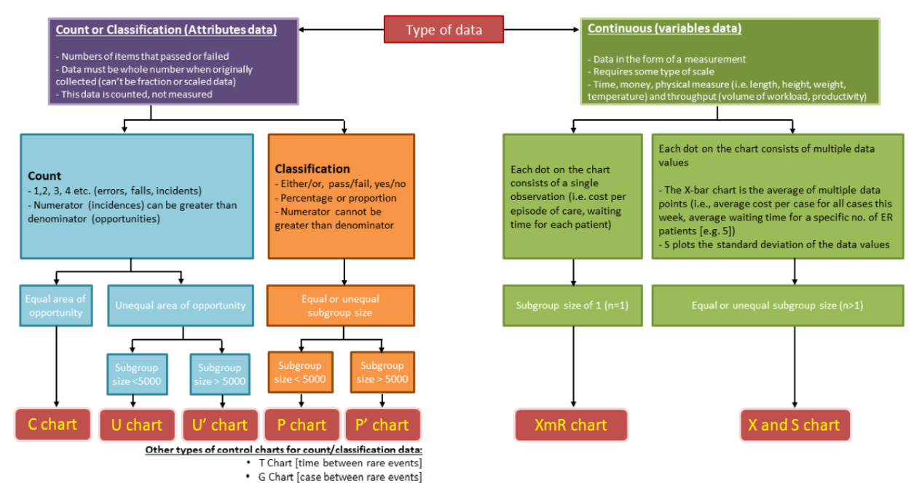

This page summarises the available control chart types and their implementation. For any other chart types that you'd like to see added, please open an issue on the [GitHub page](https://github.com/AUS-DOH-Safety-and-Quality/PowerBI-SPC).

## Why SPC?
Statistical Process Control (SPC) is a method for monitoring changes in a given outcome over time, and identifying whether a given change is large enough to be considered statistically meaningful.

Originally introduced for monitoring manufacturing processes, SPC has become a key approach for monitoring healthcare outcomes over time.

## Choosing a Chart Type
There are multiple types of SPC charts, each for monitoring a different type of data.

If you are unsure of which chart type would be most appropriate for your use-case, you can use this flow-chart to guide you.

{fig-alt="Choose Chart Type"}

Adapted from:
https://qi.elft.nhs.uk/wp-content/uploads/2020/03/how-to-use-statistical-process-control-spc-charts.pdf

### Calculating 3-sigma limits
The functions for calculating 3-sigma limits are consistent with the *R* package *[qicharts2](https://cran.r-project.org/web/packages/qicharts2/vignettes/qicharts2.html#appendix-1-calculating-3-sigma-limits)*, and are based on the formulas provided by *Montgomery (2009), Introduction to Statistical Quality Control*.

Generally, the model for calculating the lower and upper control limits for SPC charts is:

$$
\begin{aligned}
\bar{x} \pm 3SD
\end{aligned}
$$

where $\bar{x}$ is the weighted average of the sample statistic and $SD$ is the weighted sample standard deviation.

Each of the chart types have different probability models, and thus the calculation of the control limits differs between them.

| Chart Type | Assumed Distribution| Control Limits  | Assumptions |
| -- | -- | -- | -- |
| **i** | Gaussian| $\bar{x} \pm 2.66 \overline{MR}$  | $\bar{x}$ is the sample average, $\overline{MR}$ is the average moving range of successive observations, excluding unusually large moving ranges unless **Keep Outliers in Limit Calcs.** is on |
| **mr** | Gaussian| $3.267 \overline{MR}$  | $\overline{MR}$ is the average moving range (no lower 3-sigma limit) |
| **p** | Binomial| $\bar{p} \pm 3\sqrt{\frac{\bar{p}(1-\bar{p})}{n_i}}$  | $\bar{p}$ is the total number of defectives divided by the total sample size, $n_i$ is the sample size; limits are kept between 0 and 1 |
| **u** | Poisson| $\bar{u} \pm 3\sqrt{\frac{\bar{u}}{n_i}}$  | $\bar{u}$ is the average number of defects per unit, $n_i$ is the size of inspection unit; lower limits are not below 0 |
| **c** | Poisson| $\bar{c} \pm 3\sqrt{\bar{c}}$  | $\bar{c}$ is the average number of defects; lower limits are not below 0 |
| **xbar** | Gaussian| $\bar{x} \pm A_3 \bar{s}$  | $\bar{x}$ is the sample average, $A_3$ is a constant depending on the sample size, $\bar{s}$ is the weighted sample standard deviation |
| **s** | Gaussian| $CL = \bar{s}, \newline LCL = B_3 \bar{s}, \newline UCL = B_4 \bar{s}$  | $\bar{s}$ is the weighted sample standard deviation, $B_3$ and $B_4$ are constants depending on the sample size |
| **g** | Geometric| $UCL = \bar{x} + 3\sqrt{\bar{x}(\bar{x} + 1)}, \newline LCL = 0$  | $\bar{x}$ is the average number of opportunities between events; the centreline is their median |

The $p'$ and $u'$ charts are based upon the above assumptions for $p$ and $u$ charts, however they account for Laney's correction factor for prime charts from *Laney 2002, Improved Control Charts for Attributes*.

The $t$ chart three sigma limits are calculated by the $i$ chart method applied on the transformed data. Where $y$ is the time between events, it is transformed to $y^{1/3.6}$ and the $i$ chart is applied. The limits are then back transformed ($cl = cl^{3.6}$).
