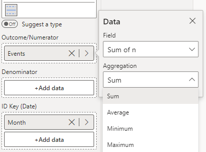

The c chart is used for monitoring the count of events that happen over time.

The c chart below shows the monthly recordings of the number of events across an 18-month period. 

To construct this chart, you provide the outcome variable of interest (number of events) in the 'Outcome/Numerator' field, and the date variable (Month) in the 'ID Key' field (depicted below). Then, select **c - Counts** from the **Chart Type** drop-down in **Data Settings**.

<iframe title="SPCVisualExamplesTesting" width="100%" height="486" src="https://app.powerbi.com/view?r=eyJrIjoiYjg0ZmZlYzQtM2MyMC00NDg0LWIwMWQtOThjNTE2ZjJhOGQ5IiwidCI6IjIzMjA0YzgxLTVlNzYtNDE0ZS04Y2M1LTYzMWI0ODc0ZTIwOCJ9&pageName=ReportSection97b01c454edfe473a3f0" frameborder="0" allowFullScreen="true"></iframe>

{fig-alt="c Chart Fields"}