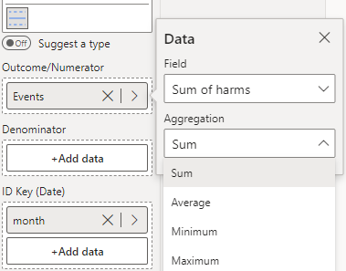

Similar to a run chart, an i Chart is used for monitoring a single observation over time. The key difference is that there are now upper and lower control limits. The width of these limits is determined by the magnitude of difference between each successive observation.

The i chart below shows the monthly recordings of the number of events across an 18-month period. 

To construct this chart, you provide the outcome variable of interest (number of events) in the 'Outcome/Numerator' field, and the date variable (Month) in the 'ID Key' field (depicted below). Then, select **i - Individual Measurements** from the **Chart Type** drop-down in **Data Settings**.

<iframe title="SPCVisualExamplesTesting" width="100%" height="486" src="https://app.powerbi.com/view?r=eyJrIjoiYjg0ZmZlYzQtM2MyMC00NDg0LWIwMWQtOThjNTE2ZjJhOGQ5IiwidCI6IjIzMjA0YzgxLTVlNzYtNDE0ZS04Y2M1LTYzMWI0ODc0ZTIwOCJ9&pageName=ReportSectiondbf937554903f9c2661a" frameborder="0" allowFullScreen="true"></iframe>

{fig-alt="i Chart Fields"}