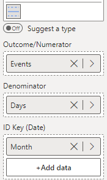

Moving Range (MR) charts plot the size of the difference between successive observations. These are used for monitoring the amount of timepoint-to-timepoint variability and are often interpreted in combination with an i-Chart.

The width of these limits is determined by the magnitude of difference between each successive observation.

The chart below is utilising a feature of the custom visual - when both a numerator and denominator is supplied to the run, i, i_m, i_mm or mr charts, the ratio of the two will be used as the outcome.

To construct this chart, you provide the numerator of interest in the 'Outcome/Numerator' field, the denominator of interest in the 'Denominator' field, and the date variable (Month) in the 'ID Key' field (depicted below). Then, select **mr - Moving Range of Individual Measurements** from the **Chart Type** drop-down in **Data Settings**.

<iframe title="SPCVisualExamplesTesting" width="100%" height="486" src="https://app.powerbi.com/view?r=eyJrIjoiYjg0ZmZlYzQtM2MyMC00NDg0LWIwMWQtOThjNTE2ZjJhOGQ5IiwidCI6IjIzMjA0YzgxLTVlNzYtNDE0ZS04Y2M1LTYzMWI0ODc0ZTIwOCJ9&pageName=ReportSection338ff82f6860e5de68ee" frameborder="0" allowFullScreen="true"></iframe>

{fig-alt="mr Chart Fields"}