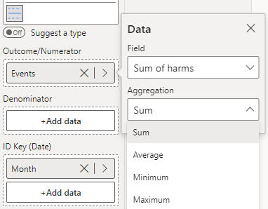

A run chart simply plots the outcome at each time point. The "target" centerline here is simply the median of all observations, and no control limits are plotted. The run chart below shows the monthly recordings of the number of events across an 18-month period. 

To construct this chart, you provide the outcome variable of interest (number of events) in the 'Outcome/Numerator' field, and the date variable (Month) in the 'ID Key' field (depicted below). Then, select **run - Run Chart** from the **Chart Type** drop-down in **Data Settings**.

PowerBI will automatically aggregate the input data if there are multiple observations for the same date, so be sure to select the appropriate aggregation for your monitoring (we have selected the sum of all events in a given month).

<iframe title="SPCVisualExamplesTesting" width="100%" height="486" src="https://app.powerbi.com/view?r=eyJrIjoiYjg0ZmZlYzQtM2MyMC00NDg0LWIwMWQtOThjNTE2ZjJhOGQ5IiwidCI6IjIzMjA0YzgxLTVlNzYtNDE0ZS04Y2M1LTYzMWI0ODc0ZTIwOCJ9&pageName=ReportSection" frameborder="0" allowFullScreen="true"></iframe>

{fig-alt="Run Chart Fields"}