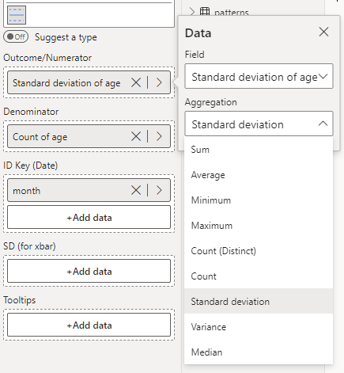

Where the Xbar chart monitors the mean of a group of observations over time, the S chart is used to monitor their standard deviation.

The S Chart below shows the monthly standard deviation of patient age over a 3-year period.

To construct this chart, you need to provide the standard deviation and count of your outcome in each time period: the standard deviation in 'Outcome/Numerator' and the count in 'Denominator'. Each period needs a count of more than one. Like with the Xbar chart, you can use PowerBI's automatic aggregation to handle this for you. See the screenshot below for an example of this. Then, select **s - Sample SDs** from the **Chart Type** drop-down in **Data Settings**.

<iframe title="SPCVisualExamplesTesting" width="100%" height="486" src="https://app.powerbi.com/view?r=eyJrIjoiYjg0ZmZlYzQtM2MyMC00NDg0LWIwMWQtOThjNTE2ZjJhOGQ5IiwidCI6IjIzMjA0YzgxLTVlNzYtNDE0ZS04Y2M1LTYzMWI0ODc0ZTIwOCJ9&pageName=ReportSection16b229bb546a64c5e98f" frameborder="0" allowFullScreen="true"></iframe>

{fig-alt="s Chart Fields"}