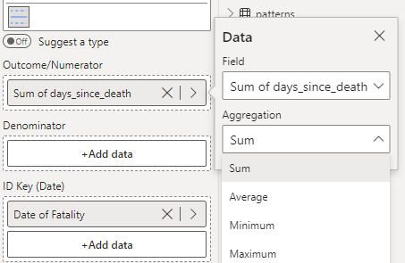

As an alternative to the g-Chart, we can instead monitor the amount of time between each event (rather than the number of non-events). This can be useful for data with no concept of a 'non-event' (i.e., there is nothing recorded until an actual event occurs).

The t Chart below monitors the number of days between each recorded surgical fatality.

To construct this chart, you provide the outcome variable of interest (number of days) in the 'Outcome/Numerator' field, and the date of each event in the 'ID Key' field, with one row per event (depicted below). The x-axis shows the event number rather than the date. Then, select **t - Time Between Events** from the **Chart Type** drop-down in **Data Settings**.

<iframe title="SPCVisualExamplesTesting" width="100%" height="486" src="https://app.powerbi.com/view?r=eyJrIjoiYjg0ZmZlYzQtM2MyMC00NDg0LWIwMWQtOThjNTE2ZjJhOGQ5IiwidCI6IjIzMjA0YzgxLTVlNzYtNDE0ZS04Y2M1LTYzMWI0ODc0ZTIwOCJ9&pageName=ReportSection8083fc94f7deeeec9b94" frameborder="0" allowFullScreen="true"></iframe>

{fig-alt="t Chart Fields"}