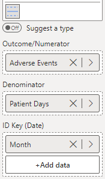

Similar to a p chart, the u Chart is used for monitoring a rate of events over time. With these kinds of data, the numerator may exceed the denominator

The u chart below shows the rate of adverse events per patient day over an 18-month period.

To construct this chart, you provide the numerator variable (number of events) in the 'Outcome/Numerator' field, the denominator variable (number of opportunities) in the 'Denominator' field, and the date variable (Month) in the 'ID Key' field (depicted below). Then, select **u - Rates** from the **Chart Type** drop-down in **Data Settings**.

<iframe title="SPCVisualExamplesTesting" width="100%" height="486" src="https://app.powerbi.com/view?r=eyJrIjoiYjg0ZmZlYzQtM2MyMC00NDg0LWIwMWQtOThjNTE2ZjJhOGQ5IiwidCI6IjIzMjA0YzgxLTVlNzYtNDE0ZS04Y2M1LTYzMWI0ODc0ZTIwOCJ9&pageName=ReportSection3cdc7588ac58fff32269" frameborder="0" allowFullScreen="true"></iframe>

{fig-alt="u Chart Fields"}