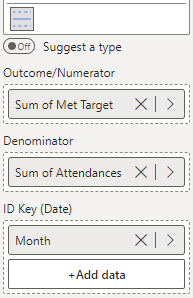

Like the p' chart, the u' chart is a u-Chart with the limits adjusted for large sample sizes.

The u' chart below shows the monthly rate of NHS emergency patients seen within 4 hours of attendance.

To construct this chart, you provide the numerator variable (number of attendances within target) in the 'Outcome/Numerator' field, the denominator variable (total number of attendances) in the 'Denominator' field, and the date variable (Month) in the 'ID Key' field (depicted below). Then, select **u prime - Rates: Large-Sample Correction** from the **Chart Type** drop-down in **Data Settings**.

<iframe title="SPCVisualExamplesTesting" width="100%" height="486" src="https://app.powerbi.com/view?r=eyJrIjoiYjg0ZmZlYzQtM2MyMC00NDg0LWIwMWQtOThjNTE2ZjJhOGQ5IiwidCI6IjIzMjA0YzgxLTVlNzYtNDE0ZS04Y2M1LTYzMWI0ODc0ZTIwOCJ9&pageName=ReportSection7189c2b05771d4850461" frameborder="0" allowFullScreen="true"></iframe>

{fig-alt="up Chart Fields"}