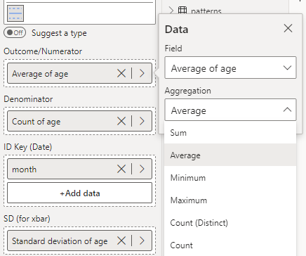

Where the i Chart is used for monitoring a single observation, the Xbar Chart is used for monitoring the average of multiple observations over time. The width of the chart's control limits is determined by the number of observations and their standard deviation.

The Xbar chart below shows the monthly average age of patients over a 3-year period.

To construct this chart, you need to provide the mean, count, and standard deviation of your outcome in each time period: the mean in 'Outcome/Numerator', the count in 'Denominator' and the standard deviation in 'SD (for xbar)'. Each period needs a count of more than one. Thankfully, you can use PowerBI's automatic aggregation to handle this for you. See the screenshot below for an example of this. Then, select **xbar - Sample Means** from the **Chart Type** drop-down in **Data Settings**.

<iframe title="SPCVisualExamplesTesting" width="100%" height="486" src="https://app.powerbi.com/view?r=eyJrIjoiYjg0ZmZlYzQtM2MyMC00NDg0LWIwMWQtOThjNTE2ZjJhOGQ5IiwidCI6IjIzMjA0YzgxLTVlNzYtNDE0ZS04Y2M1LTYzMWI0ODc0ZTIwOCJ9&pageName=ReportSectionb88d4577ec6baff7a92c" frameborder="0" allowFullScreen="true"></iframe>

{fig-alt="xbar Chart Fields"}