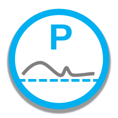
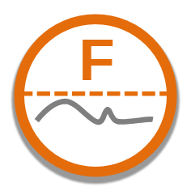

Assurance icons show how consistently a measure can be expected to meet the target set for it. There are three icons:

| Icon | Definition |
| -- | -- |
|  | Variation indicates **inconsistently** hitting, passing and falling short of the target. This means that the target may sometimes be met and sometimes missed due to random variation. |
|  | Variation indicates consistently **(P)assing** the target. |
|  | Variation indicates consistently **(F)alling short** of the target. |

The visual compares the **Additional Target Value** with the last point's three-sigma (99%) limits. A target between the limits gives the hit or miss icon (shown as *Inconsistent* in the summary table's filter). A target beyond the limits gives a pass when the process sits on the favourable side of it, and a fail otherwise: for example, with an **Improvement Direction** of Increase, a target below the lower limit is a pass and a target above the upper limit is a fail.

The icon needs **Show Alt. Target Line** turned on in **Line Settings** and an **Improvement Direction** of Increase or Decrease; run charts show no assurance icon.

For more information on assurance icons, please see the NHS guide: [Making data count - Strengthening your decisions](https://www.england.nhs.uk/wp-content/uploads/2019/12/making-data-count-strengthening-your-decisions.pdf). 