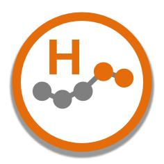
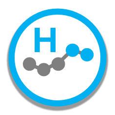

Variation icons show whether a measure has special cause variation, and whether that variation is improving or concerning. There are four types of icon:

| Icon | Definition |
| -- | -- |
|  | Common Cause Variation which indicates that there is no significant change in the process |
|   | Special cause variation of **concerning** nature due to **(H)igher** or **(L)ower** values |
|   | Special cause variation of **improving** nature due to **(H)igher** or **(L)ower** values |
|   | Special cause variation due to **higher** or **lower** values, when the **Improvement Direction** is Neutral |

The icons are based on the patterns turned on in **Outlier Settings**; with none turned on, the icon is always common cause. By default only the patterns at the last point are considered (**Flag Only Last Point**); turning it off considers every point. More than one icon shows when patterns in both directions are found. See [NHS Icons](../SettingsReference/nhsIcons.html) for these settings.

For more information on variation icons, please see the NHS guide: [Making data count - Strengthening your decisions](https://www.england.nhs.uk/wp-content/uploads/2019/12/making-data-count-strengthening-your-decisions.pdf). 