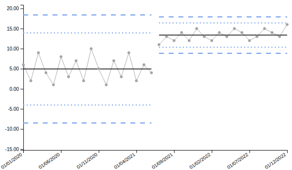
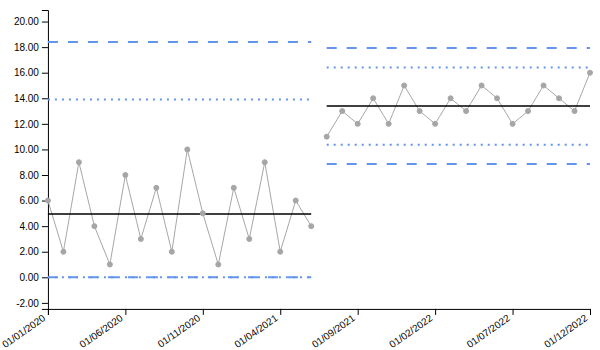

With the data settings, the key settings used to display the SPC chart can be modified.

## Chart Type
The SPC visual is set to individual measurements (i) charts by default, also known as XmR charts. There are other options available which use an assumed probability model to compute the 3-sigma limits. See the documentation on Chart Types for further details on each type.

## Keep Outliers in Limit Calcs.
By default (off), unusually large moving ranges are dropped before the limits are calculated, so that a single extreme point doesn't widen the limits. A moving range counts as unusually large when it is at least 3.267 times the average moving range (3.865 times the median moving range for i_mm charts). Turning this option on keeps them. It applies to the i, i_m, i_mm, t, p prime and u prime charts.

## Multiplier
The multiplier affects the scale of the final value that is displayed in the SPC chart, with the default set to 1 for every chart type. For p and p prime charts, **Report as percentage** (Automatic by default) shows a multiplier of 1 as a percentage, multiplying by 100.

## Decimals to Report
Sets the number of decimal places reported in the y-axis, tooltips and values written on lines. The number of decimal places in the y-axis can be overridden by **Tick Decimal Places** in the **Axis** group of the Y-Axis Settings.

## Report as percentage
A drop down box to set whether the value should be reported as a percentage. This setting has three options:

- When set to **Automatic**, the chart will report as percentage when a p or p prime chart type is selected, with a multiplier of 1 or 100.
- When set to **Yes**, the chart will always report as percentage, multiplying by 100 in place of the **Multiplier**.
- When set to **No**, the chart will not report as percentage.

The conditional formatting follows the same values as the drop down box.

## Split Limits on Click
The split limits on click toggle allows users to click on multiple points in the SPC to recalculate the control limits for all the points before and including the clicked point, and all the points after the clicked point.

An example of this is below:

{fig-alt="Split Limits on Click Example"}

Developers are also able to toggle on the ability to split limits, set the location of your split limits, then toggle off the feature. This is useful when there is a clear process change and the limits need to be reset, but the functionality to split limits does not need to be carried into the published dashboard.

To reconcile the split limits, click on the same point that was initially clicked to split the limits (the last point in the limit series).

## Truncate Lower and Upper Limits at
The lower and upper limits are able to be truncated using this setting, which sets a minimum and a maximum for the limits.

A use case for this would be in the example above for split limits, where the lower control limit is below 0 and into the negatives. Although theoretically possible using the i-chart probability model, practically this may not make sense for your measure if negative values are not possible. The lower control limit may be truncated to zero by setting this option:

{fig-alt="Truncate Limits Example"}

## All Settings


