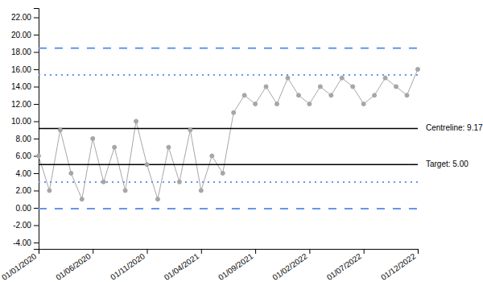

With the line settings, users can modify the width, type and colour of the lines in the SPC chart. Each line has its own group of settings, listed below.

## Additional Target Value
By default, the SPC chart depicts a statistical centerline as set by the chart type. This allows for a comparison of how the process may be changing over time, relative to historical results. However, there are applications where a target value may be appropriate to include as well. This can be set using **Additional Target Value** in the **Alt. Target** group, with **Show Alt. Target Line** turned on. The value is entered as a plotted value; turn on **Apply Multiplier to Alt. Target** to enter it as a raw proportion or rate instead.

The example below sets an additional target line at 5, and turns on **Show Value on Plot** for the target and alt. target lines to label them. The additional target line is black by default; its colour, width and type are set in the same group.

{fig-alt="Additional Target Value Example"}

## All Settings


