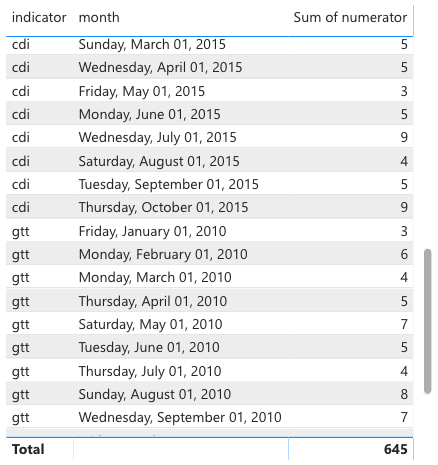
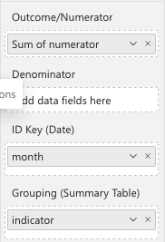
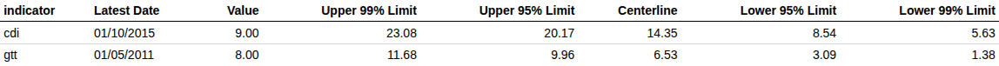
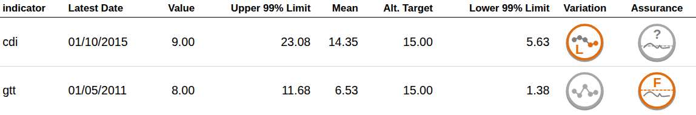
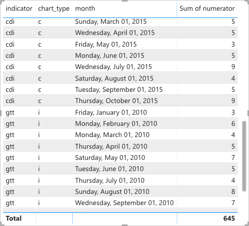
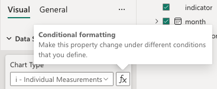
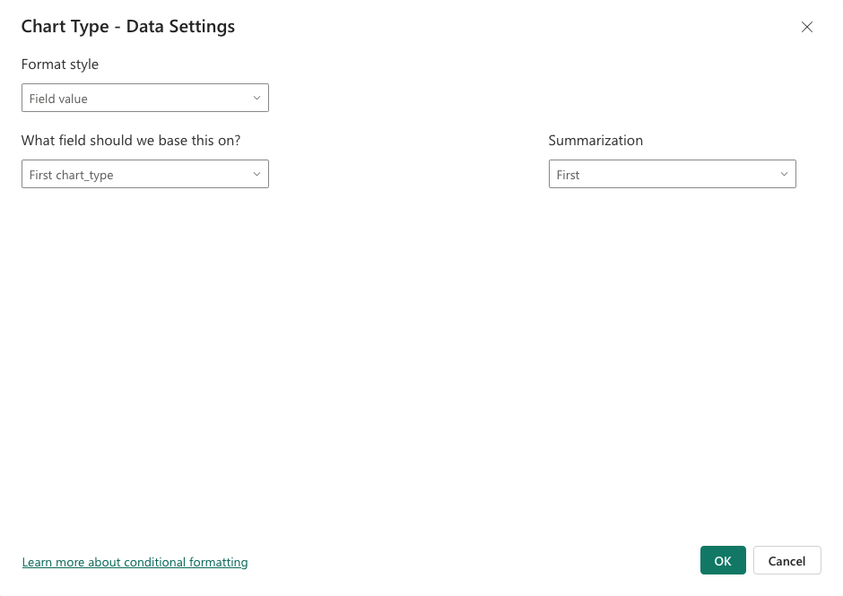

Rather than displaying a SPC chart for a single indicator or group, it is often desirable to display a summary of the calculations and outlier status for multiple groups/indicators. The SPC visual provides this grouped calculation/display, with full support for outlier detection (and NHS Iconography), conditional formatting for each group, as well as the usual cross-plot interactivity and highlighting.

## Getting Started

### Data Structure

Consider a table of observations from two indicators, containing the following columns:

  - `indicator`
  - `month`
  - `numerator`

Viewed as a table in PowerBI, this looks like:

{fig-alt="ExampleData"}

To create a summary table in the SPC visual, simply add the `indicator` column to the `Grouping (Summary Table)` field:

{fig-alt="TableInputs"}

The visual will then automatically change to a Table view, displaying the results of the SPC calculations for each group:

{fig-alt="ExampleTable1"}

### Table Columns

To add/remove columns from the table, simply use the existing settings for adding/removing plotted series in the SPC chart. The table will automatically update to reflect the changes.

For example, to remove the 95% control limits from the table, simply switch off the `Show 95% Lines` setting in the `95% Limits` group of the `Line Settings` card.

To change the names of particular columns, the existing `Tooltip Label` settings can be used. For example, the default name for the center line is `Centerline`, but this can be changed to `Mean` by changing the `Tooltip Label` setting in the `Target` group of the `Line Settings` card.

#### NHS / Making Data Count Icons

The same approach is used to add the NHS / Making Data Count icons to the table. Simply enable the Variation or Assurance icons in the existing `NHS Icons Settings` card. The variation icons summarise the patterns turned on in `Outlier Settings`, and the assurance icons need the `Show Alt. Target Line` setting turned on with an `Additional Target Value` (see [NHS Icons](SettingsReference/nhsIcons.html)). The example below turns on all four patterns and sets an alt. target of 15, along with the `Mean` label from above, and larger fonts and icons.

The table will then automatically update to display the icons for each group:

{fig-alt="NHSIconsDisplayed.png"}

### Table Aesthetics

A number of settings are available to customise the appearance of the table, including font size, font colour, background colour, and more. These settings can be found in the `Summary Table Settings` card, with a separate group for each type of setting.

### Conditional Formatting

As with the standard SPC visual, conditional formatting can be used to customise the calculation and rendering for each group.

For example, we might want to use a different chart type for each group. Given a column/measure with the desired chart type for each indicator:

{fig-alt="ExampleDataChartType"}

This can be provided to the `Chart Type` conditional formatting input:

{fig-alt="ChartTypeCondFormatting1"}
{fig-alt="ChartTypeCondFormatting2"}

Each group's limits will then be calculated with its own chart type. The same approach works for other settings that affect each group's calculations, icons and row formatting; which columns appear, and their names, follow the first group's settings.
